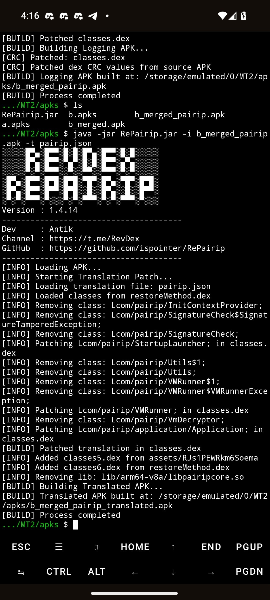
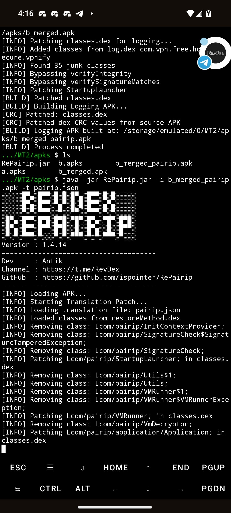

# RePairip


> **Current version:** 1.8.30 | **Language:** Java 17

RePairip is a Google加固 reverse engineering tool that can dump all VMRunner snapshots and fully repack Android applications, removing protection layers completely.


## Tutorial

[Watch Video on RevDex.Re](https://revdex.re/input.mp4)


[Watch Video on Telegram](https://t.me/RevDex/557)

| App UI | Dump Style |
| --- | --- |
|  |  |


## License

This project is distributed under the Apache License 2.0.

```text
Apache License
Version 2.0, January 2004
https://www.apache.org/licenses/
```

Copyright (C) 2024 HighCapable
## RePairip User Guide

First back up your APK using any APK extractor, okay? Save it as an `.apks` file. After that, save the `RePairip.jar` file in the same directory, okay? Then run the command below. Before running this command, make sure you have installed JDK 17 in your Termux. If you are a Windows user, make sure you have installed JDK 17 on your Windows system, okay? It is required to run the JAR file.

```bash
java -jar RePairip.jar -i yourappname.apks
```

After running this command, you will see `yourappname_merged.apk` or `yourappname_patched.apk`. Now you can install `_patched.apk` on your Android device, okay? Remember, this app is not signed, okay? It has no signature, so don't worry. Many people get confused at this point about how it is possible to install an unsigned app, right? In this case, you can use CorePatch, okay? `CorePatch.apk` is an LSPosed/Xposed-based module. This module basically allows you to disable the Package Manager's signature verification system. You can install unsigned APKs on your device. After that, you can directly install `yourappname_patched.apk` as an unsigned app. If you try to open the app directly, it will crash. At this point, you can extract `base.apk` from the original `.apks` file, okay? Then replace the `base.apk` inside the installed app's directory:

```text
/data/app/~~pCAdxhh9Sqoldk3Wn2nleg==/com.aantik.a-SZfLNIAP1Op33HkmKM0Yug==/
```

The app directory looks like this. Every app has its own directory. Inside this directory, you already have the patched `base.apk` file. Now, at this point, you can replace the patched `base.apk` with your extracted original `base.apk`, okay, fine. I know you have a question. Let me explain. Look at this point: when you install `patched.apk`, Android creates VDEX or ODEX files inside the app directory, all right? These VDEX or ODEX files basically contain your patched code. Now the app doesn't detect it. The app just checks whether `base.apk` has been modified or not, right? Now I have replaced it with the original APK, so the app runs without detection, but the VDEX or ODEX files still contain the patched code, so my hook works. All VMRunner static fields, strings, and objects are dumped, as we can see, inside the app's root data directory in the `pairip.json` file, okay? Now you can collect `pairip.json`, okay, fine. :)
Now you can run the command below to set all dumped PAIRIP VMRunner runtime capture data as static values, okay?

```bash
java -jar RePairip.jar -i yourappname_merged.apk -t pairip.json
```

Remember make sure you select `_merged.apk`, okay? Because this app doesn't contain patched code like the VMRuntime dumper. This app is fresh and clean, just a simple anti-split APK, okay? Now, after running this command, you will get a final APK.

Enjoy! :) You have successfully bypassed the whole Google加固 protection


## Frida RePairip Capture without CorePatch (Optional)

The classic root flow installs the logging APK with signature verification
disabled. On Android 15 the runtime logging patch also needs the AOT/dex swap
dance, and any modified APK kills the PairIP VM before it populates classes.

The Frida path skips all of it: keep the Play-signed APK installed, launch it,
and dump the populated junk-class fields to `pairip.json`. Then translate the
clean merged APK and sign it normally.

```bash
java -jar RePairip.jar -i app.apks                       # merged APK
# launch the Play-installed app, then:
python3 frida/capture_pairip.py -p <package> -c junk_classes.txt -o pairip.json
java -jar RePairip.jar -i app.apks -t pairip.json        # translated APK
```

Requires frida-server and a matching Frida Python client on 16.x (Frida 17
removed the Java bridge). Root is still required for frida-server to attach to
the app; the Frida path only removes CorePatch and the patched-APK install.
Builds from `main` write `junk_classes.txt` themselves; the `JunkClasses.java`
step is only needed for the 1.8.30 release JAR. No CorePatch, no `su` install,
no base.apk replacement. See `frida/README.md` for the full procedure and
troubleshooting.
