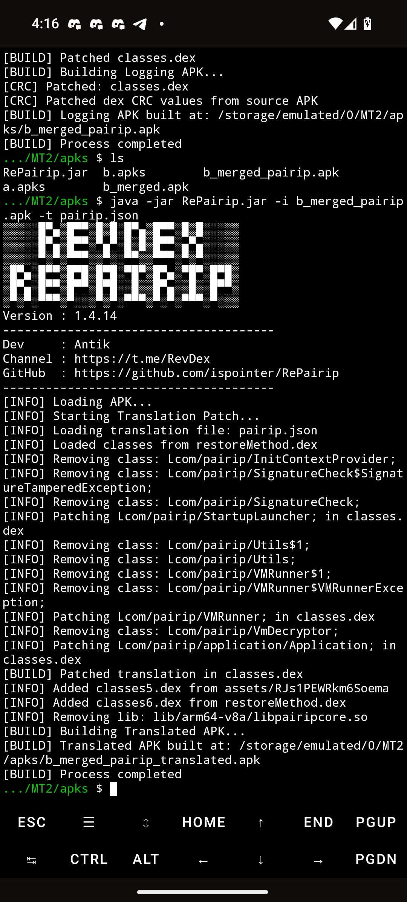
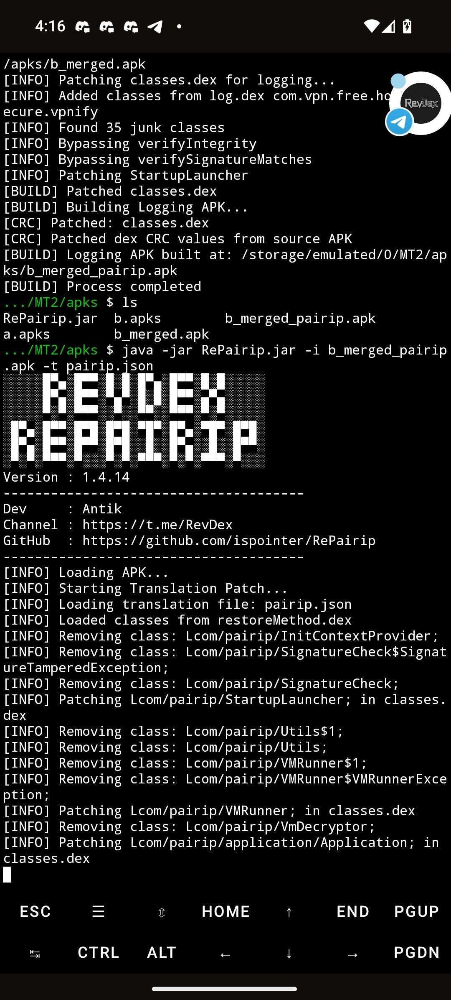

<p align="center">
  
</p>

<h1 align="center">RePairip</h1>

<p align="center">
  RePairip is a Google加固 reverse engineering tool that can dump all VMRunner snapshots and fully repack Android applications, removing protection layers completely
</p>

<p align="center">
  <b>Current version:</b> 1.6.30 &nbsp;|&nbsp;
  <b>Language:</b> Java 17 &nbsp;|&nbsp;
  <b>Build:</b> Gradle + Shadow Jar
</p>


## Tutorial

[Watch Video on RevDex.Re](https://revdex.re/input.mp4)


[Watch Video on Telegram](https://t.me/RevDex/557)

| App UI | Dump Style |
| --- | --- |
|  |  |


## License

This project is distributed under the Apache License 2.0.

```text
Apache License
Version 2.0, January 2004
https://www.apache.org/licenses/
```

Copyright (C) 2026 HighCapable
